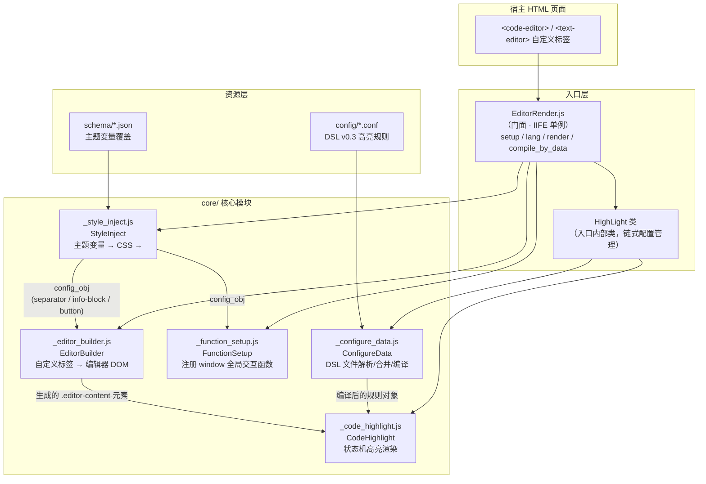
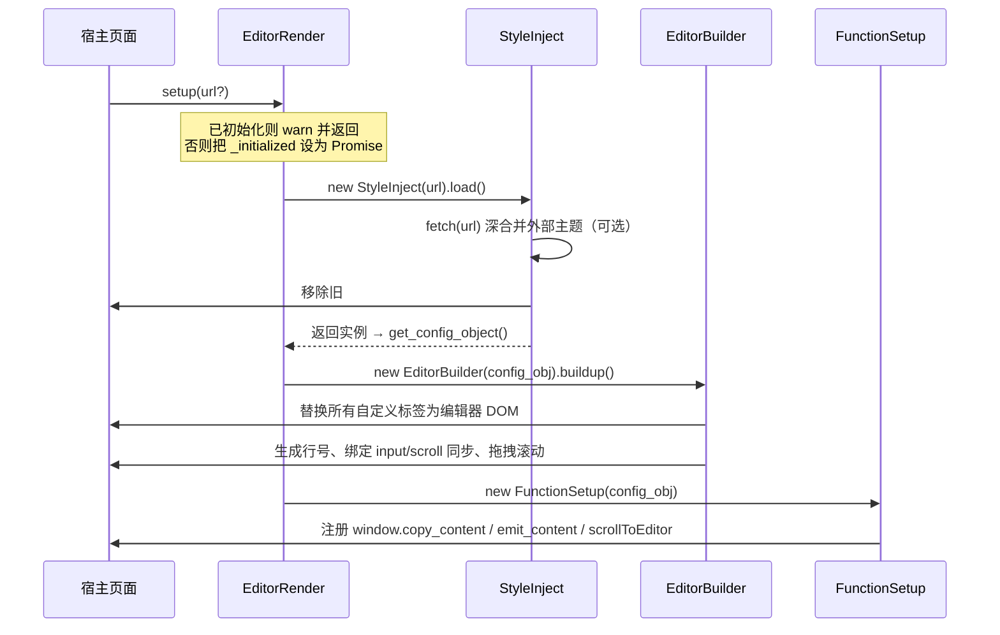
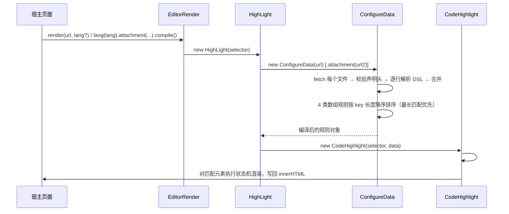

# 整体架构

## 架构概览

EditorRender 是一个**零依赖、无构建步骤**的纯浏览器端库，采用经典的**门面（Facade）+ 职责分层**结构：入口模块只做编排，5 个核心模块各管一件事。



## 职责分层

| 层 | 模块 | 单一职责 |
|---|---|---|
| 入口层 | `EditorRender.js` | 生命周期编排（只允许初始化一次）、按语言生成选择器、暴露 4 个静态方法 |
| 入口层 | `HighLight`（内部类） | 高亮配置的三种加载模式互斥管理（单文件 / 多文件合并 / 直接数据） |
| 核心层 | `StyleInject` | 内置主题 + 外部 JSON 深合并 → 生成 CSS 字符串注入 `<head>`；导出 UI 配置对象 |
| 核心层 | `EditorBuilder` | 自定义标签 → 完整 DOM（头部/行号/内容区），绑定行号同步与拖拽滚动 |
| 核心层 | `FunctionSetup` | 把复制/提交/滚动定位挂到 `window` 供内联 `onclick` 调用，管理按钮状态反馈 |
| 核心层 | `ConfigureData` | fetch 加载 `.conf` → 逐行解析 DSL → 合并多文件 → 排序输出规则对象 |
| 核心层 | `CodeHighlight` | 按规则对象对 `.editor-content` 文本做状态机扫描，生成带 `<span>` 的 HTML |

## 初始化时序（setup 阶段）



要点：

- `_initialized` 存的是 **Promise** 而非布尔值，并发调用 `lang()/render()` 时 `await setup(null)` 会等待同一个 Promise；初始化抛错时重置为 `null` 允许重试。
- `StyleInject` 产出的 `config_obj`（`separator` / `info-block` / `button` 三段）是 `EditorBuilder` 与 `FunctionSetup` 的共同输入——**样式配置不仅用于 CSS，也驱动 DOM 中按钮/分隔符的生成**。

## 高亮渲染时序（render 阶段）



选择器约定：`render(url, 'Java')` → `.code-editor .editor-body .editor-content.Java`，即 `lang` 参数直接拼成类名。

## 高亮状态机（CodeHighlight 核心）

渲染优先级：**enclose-doc > enclose-hig > enclose-low > pre-token > keyword**

```mermaid
stateDiagram-v2
    [*] --> default
    default --> hig : 匹配 enclose-hig 左边界
    default --> doc : 匹配 enclose-doc 左边界
    default --> low : 匹配 enclose-low 左边界
    hig --> default : 匹配右边界（内部无任何渲染）
    low --> hig : 内部可再嵌套 enclose-hig
    low --> default : 匹配右边界
    doc --> default : 匹配右边界（内部仅渲染 doc-token）
```

每轮循环先尝试 `#close_innermost` 关闭最内层包围（hig → doc → low），再按当前状态分派处理函数：

| 状态 | 行为 |
|---|---|
| `default` | 依次尝试：预扫描的 pre-token 词条 → enclose-doc 左边界 → enclose-hig → enclose-low → keyword 整词 → 转义输出单字符 |
| `hig` | 纯吞字符（字符串/注释内部不高亮） |
| `doc` | 仅匹配 `doc-token`（如 `@param`） |
| `low` | 吞字符，但允许开启 `enclose-hig`（如注解内的字符串） |

## 编译产物数据结构

`ConfigureData.compile()` 的输出（也是 `CodeHighlight` 构造参数、`compile_by_data()` 期望的输入）：

```json
{
  "enclose-hig": [ {"\"": {"rig": "\"", "color": "#CE9178"}} ],
  "enclose-doc": [ {"/**": {"rig": "*/", "color": "#D4D4D4"}} ],
  "enclose-low": [ {"@": {"rig": " ", "color": "#AA7530"}} ],
  "pre-token":  [ {":": "#CE9178"} ],
  "doc-token":  { "@param": "#4EC9B0" },
  "keyword":    { "function": "#569CD6" }
}
```

- `enclose-*` 与 `pre-token` 是**数组**（对象单键），编译时按键长**降序**排序，保证 `'/**'` 优先于 `'/*'`、`'::'` 优先于 `':'` 的最长匹配；
- `doc-token` 与 `keyword` 是**字典**（token → color），多文件合并时同名键直接覆盖。

## 设计模式

| 模式 | 体现 |
|---|---|
| 门面（Facade） | `EditorRender` 隐藏 5 个核心模块的协作细节 |
| 单例（变体） | IIFE + 闭包 `_initialized`，全局仅一次初始化 |
| 构建器（Builder） | `EditorBuilder` 分步构造 DOM 并绑定事件 |
| 状态（State） | `CodeHighlight.#state_handler` 按状态返回绑定的处理函数 |
| 策略/链式（Fluent） | `HighLight.attachment()` 返回 `this` 支持链式累积配置 |
| 模板方法 | `StyleInject.#css()` 用主题对象拼接固定 CSS 骨架 |

## 数据流小结

```
主题 JSON ──► StyleInject ──► CSS + config_obj ──► EditorBuilder ──► 编辑器 DOM
                                                └─► FunctionSetup ─► window 全局函数
DSL .conf ──► ConfigureData ──► 规则对象 ──► CodeHighlight ──► innerHTML（<span> 高亮）
```
