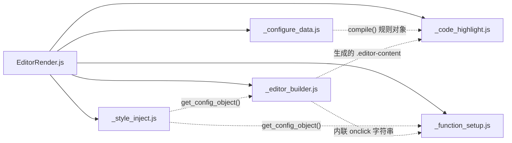

# 依赖关系与已知问题

## 外部依赖

**运行时第三方依赖：零。** 无 `package.json`、无 npm 包、无构建工具。

### 浏览器 API 依赖

| API / 特性 | 用途 | 兼容性要求 |
|---|---|---|
| ES Modules（`import`/`export`） | 模块组织 | 所有现代浏览器 |
| 类私有字段 `#field` | 全部 5 个核心类 | ES2022，Chrome ≥ 74 / Firefox ≥ 90 / Safari ≥ 15 |
| 正则后行断言 `(?<!...)` + sticky `/y` | `CodeHighlight.#RE_WORD` 整词匹配 | Safari ≥ 16.4 |
| `fetch` | 加载 `.conf` / 主题 JSON | 需 HTTP(S) 上下文 |
| `navigator.clipboard.writeText` | 复制按钮 | 需安全上下文（HTTPS 或 localhost） |
| DOM API（`querySelectorAll`、`outerHTML`、`closest`…） | 构建与渲染 | — |
| `Blob` + `URL.createObjectURL` + `<a download>` | `ConfigureData.output()` 浏览器导出 | — |

### 可选 Node.js 依赖

`ConfigureData.output()` 在非浏览器环境下动态 `import('fs')` / `import('path')` 写文件；浏览器环境永不触发该分支。

## 内部模块依赖图



- 实线 = `import` 静态依赖（全部集中在入口模块，核心模块之间**互不 import**）；
- 虚线 = 运行时数据/DOM 耦合；
- `FunctionSetup` 与 `EditorBuilder` 之间通过 **window 全局函数名**（`copy_content` / `emit_content` / `scrollToEditor`）隐式耦合——这是 README 中列为重构方向第 1 条的原因。

## 调用链全景

```
用户代码
 ├─ EditorRender.setup(url?)
 │   ├─ StyleInject.load()            → fetch(主题JSON)? → 注入 <style>
 │   ├─ StyleInject.get_config_object()
 │   ├─ EditorBuilder.buildup()       → 标签替换 → 行号 → 事件绑定
 │   └─ new FunctionSetup()           → window.copy_content / emit_content / scrollToEditor
 │
 └─ EditorRender.render(url, lang)    =  lang(lang).render(url)
     └─ EditorRender.lang(lang)       → new HighLight(selector)
         ├─ .attachment(url)*.compile()  或  .render(url)
         │   └─ ConfigureData.compile() → fetch → DSL 解析 → 排序合并
         └─ new CodeHighlight(selector, data).render()
             └─ #do_render() 状态机扫描 → element.innerHTML
```

## 已知问题

以下问题均在源码中确认（本项目为学习项目，作者已声明未经充分测试）：

| # | 位置 | 问题 | 影响 |
|---|---|---|---|
| 1 | `EditorRender.js` `HighLight.compile_by_data` | 条件写反：`if (!this.#attaching)` 时报错返回 `null`，导致**正常调用（未附加配置时）必然失败**；错误文案也与场景不符 | `EditorRender.compile_by_data()` 与 `hl.compile_by_data()` 当前不可用 |
| 2 | `_code_highlight.js` `render()` | 防重复渲染标志 `#initialized` 从未被置 `true` | 重复调用不会警告，总是全量重渲染（功能正确，仅保护失效） |
| 3 | `_function_setup.js` `emit_content` | 提交功能为占位实现：仅打印日志 + 500ms 模拟，**不发送任何请求**，传入的 `url` 未使用 | `<text-editor submit="...">` 的提交按钮无实际效果 |
| 4 | `_editor_builder.js` `#drag_scroll` | 每个编辑器都在 `document` 上注册 `mousemove`/`mouseup` 监听，且无移除逻辑 | 编辑器很多时存在监听器累积 |
| 5 | `_configure_data.js` `output(root, name)` | 参数顺序为 `(root='./', name)`，与直觉相反 | `output('name')` 会因缺少 `name` 抛错；须用 `output('./', 'name')` |
| 6 | `_configure_data.js` `#setup` | 行号计数从 1 开始且循环开头先自增，警告中的行号比实际大 1 | 仅影响报错定位体验 |
| 7 | `EditorRender.js` `lang()/render()` | `if (lang || lang !== '')` 恒为真（逻辑冗余） | 无实际影响，语义上是"始终拼接类名" |
| 8 | 全局 | 交互依赖 `window` 全局函数 + 内联 `onclick` 字符串 | 污染全局命名空间；与严格 CSP（禁内联事件）不兼容 |
| 9 | `_style_inject.js` `#inject` | 外部主题 JSON 只能覆盖已有键，无法新增键 | 扩展主题结构需改源码 |
| 10 | 高亮选择器 | `lang` 直接拼为 CSS 类名且大小写敏感 | `lang="Java"` 与 `render(url, "java")` 不匹配 |

## 官方路线图（来自 Readme）

1. 重构 `_function_setup`，不再使用全局函数（对应问题 #8）；
2. 重构 `_code_highlight`，弃用状态机，改为 **栈 + 指针** 逐块处理；
3. 增加**虚拟滚动、懒分块渲染**能力。

## 适用场景声明

- ✅ 个人博客代码展示、学习项目原型、轻量文档站点、演示页面
- ❌ 企业级生产环境、要求严格稳定性的项目、处理敏感数据的场景

作者推荐的生产级替代：CodeMirror、Monaco Editor、PrismJS、Highlight.js。
